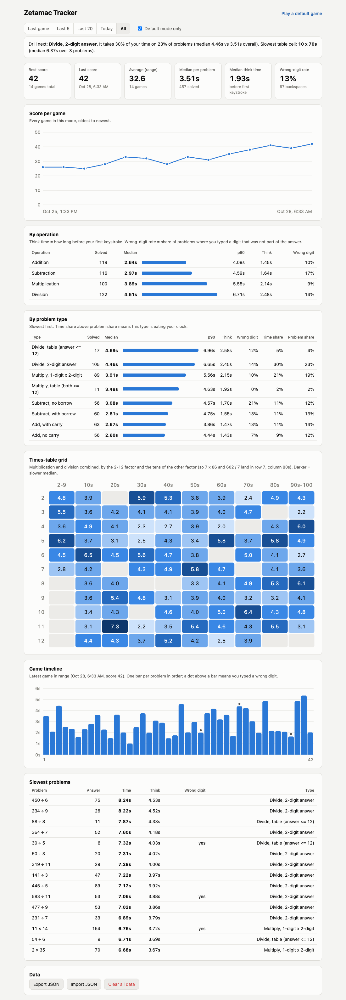

# Zetamac Tracker

**See exactly where your two minutes go on [Zetamac](https://arithmetic.zetamac.com/).**

Zetamac gives you a single number at the end of a game. That number tells you whether you're getting faster. It doesn't tell you *why* you're stuck. Zetamac Tracker is a small Chrome extension that times every problem you see and breaks your games down by operation, problem type and times-table cell, so you can drill the thing that's actually costing you points.



<sub>Dashboard with sample data. It follows your system light/dark setting.</sub>

## What it measures

For every problem:

| Metric | Meaning |
|---|---|
| **Time** | From the moment the problem appears until the correct answer is in the box |
| **Think time** | How long before your first keystroke. Long think time means slow recall; short think time with a long total means slow typing or corrections |
| **Wrong digit** | You typed a digit that is not part of the answer. Zetamac never rejects an answer (it just waits), so this is what a "miss" is |
| **Backspaces** | How many times you deleted |
| **Type** | Add with or without carry, subtract with or without borrow, table multiplication (both factors <= 12) vs 1-digit x 2-digit, table division vs 2-digit answer |
| **Times-table cell** | The 2-12 factor and the tens of the other factor. 7 x 86 and 602 / 7 both land in row 7, column 80s |

The dashboard turns those into:

- **Drill next**: the problem type taking the biggest share of your clock compared with how often it shows up, plus your slowest times-table cell
- **Summary tiles**: best and last score, range average, median time per problem, median think time, wrong-digit rate
- **Score per game**: your trend over time, with hover details
- **By operation** and **by problem type**: count, median, p90, think time, wrong-digit rate, share of time vs share of problems
- **Times-table heatmap**: multiplication and division combined, darker = slower
- **Game timeline**: one bar per problem in your latest game, with wrong digits marked
- **Slowest problems**: the 15 slowest across the selected range

Filter by **Last game / Last 5 / Last 20 / Today / All**. **Default mode only** (on by default) keeps the stats to the standard 120-second, all-operations game, so scores stay comparable.

A short summary also appears right under the game when time runs out.

## Install

The extension isn't on the Chrome Web Store. Load it from source; it takes about a minute.

1. Clone the repo:
   ```
   git clone https://github.com/paarth-r/zetamac-tracker.git
   ```
2. Open `chrome://extensions` in Chrome (Edge, Brave and Arc work the same way).
3. Turn on **Developer mode** (top right).
4. Click **Load unpacked** and pick the `zetamac-tracker` folder.
5. Pin the extension so its icon stays in the toolbar.

To update later, run `git pull` and click the reload icon on the extension's card in `chrome://extensions`.

## Use

1. Play Zetamac as normal. Every game at `arithmetic.zetamac.com/game` is recorded automatically. There's nothing to start or stop.
2. When time runs out, a summary appears under the game. Click **Open dashboard**, or click the toolbar icon whenever you like.
3. Keep the dashboard open in a second tab while you practice. It updates by itself as each game finishes.

Tips for using the data:

- **Look at problem type before operation.** "Division is slow" is too vague to practice. "2-digit-answer division is 27% of my time" is something you can drill.
- **Compare think time to total time.** If think time is most of the total, you need faster recall (times tables, splitting tricks). If it's a small part, look at typing speed and wrong digits.
- **Judge trends, not single games.** One score bounces around a lot. Look at the "Last 20" average.

### Your data

Everything stays in your browser (`chrome.storage.local`). Nothing is sent anywhere, and the extension has no network access of its own. Under **Data** on the dashboard:

- **Export JSON**: back up your history or move it to another browser
- **Import JSON**: merge an export back in (games already present are skipped)
- **Clear all data**: requires a second click to confirm

Removing the extension deletes its data, so export first if you want to keep it.

## How it works

- `src/content.js` runs on Zetamac game pages. It watches the problem text and the answer box. A capture-phase `input` listener sees each keystroke before Zetamac's own handler clears the box, and times are taken with `performance.now()`.
- When the clock hits zero, the problem still on screen is stored as unsolved (it's left out of timing stats) and the game is saved.
- `src/lib.js` holds all the parsing, classification and statistics as pure functions, shared by the recorder, the dashboard and the tests.
- `dashboard.html` with `src/dashboard.js` is a plain-JS dashboard. It has no dependencies, draws its charts with hand-written SVG, and loads nothing remote.

**Accuracy:** the end-to-end test plays a real game and compares the stored timings with the per-problem log Zetamac itself sends to its server. They agree to within about 1 ms.

## Development

Requires Node 18+.

```
npm install
npm test                    # unit tests for parsing, classification and stats
npm run test:e2e            # live end-to-end test (see below)
HEADED=1 npm run test:e2e   # same, with a visible browser
```

The end-to-end test launches Chromium with the extension loaded, has a bot play a real 30-second game on the live site (with a wrong digit and a backspace planted on every 4th problem), then checks the stored game: score, problem count, planted errors, and timings against Zetamac's own log. It needs Playwright's Chromium once: `npx playwright install chromium`. It plays on the real site, so run it when you change the recorder, not in a loop.

### Project layout

```
manifest.json        MV3 manifest: content script on zetamac game pages, toolbar action
src/lib.js           pure analysis helpers (no DOM, no chrome.*)
src/content.js       recorder + end-of-game summary
src/background.js    opens the dashboard
dashboard.html       dashboard markup
src/dashboard.js     dashboard rendering, filters, import/export
src/dashboard.css    dashboard styles (light/dark tokens)
test/lib.test.js     unit tests (node:test)
test/e2e.mjs         live-site Playwright test
AGENTS.md            instructions for coding agents working in this repo
```

### Stored data format

`chrome.storage.local` holds one key, `games`, an array of:

```js
{
  version: 1,
  id: "1761674400000",          // start time as a string
  startedAt: 1761674400000,     // epoch ms
  settings: { add: true, ... }, // Zetamac's init() options, parsed from the page
  duration: 120,
  isDefault: true,              // standard 120 s, all-operations game
  score: 26,
  problems: [{
    text: "7 × 86", op: "mul", a: 7, b: 86, answer: 602,
    category: "mul-2digit", small: 7, big: 86,
    ms: 4210, solved: true,
    firstInputMs: 2380, errors: 0, backspaces: 0, keystrokes: 3
  }]
}
```

## Contributing

Issues and pull requests are welcome. Please run `npm test` (and `npm run test:e2e` if you touched `src/content.js`) before opening a PR. If you're using a coding agent, point it at [AGENTS.md](AGENTS.md).

## License

[MIT](LICENSE). Not affiliated with Zetamac.
